<div align="center">

# Sketch de plastilina

**Sketches cómicos en 3D de plastilina, con personajes que hablan y mascotas de IA, a partir de un tema.**

Un skill de Claude Code con motor propio en Blender. Le das un tema y te entrega un video vertical
de 60-70 s: guion, voces, lip-sync, puesta en escena, cámaras, subtítulos, SFX y mezcla.


</div>

---

## El formato

Nace de **«A escondidas»**, un sketch de 70 s. Santi usa IA a escondidas en la oficina de noche y Clawd
lo cubre desde distintos escondites. El ChatGPT del jefe, sentado en su hombro, lo delata con un recibo
de «cuarenta y siete» mensajes. Al final, Gemini le susurra algo a Mariana.

<table>
<tr>
<td width="34%" valign="top"></td>
<td valign="top">

**Por qué funciona**

- **Hook en los primeros 2 s**: una situación que la gente ya vive con la IA.
- **Revelaciones que escalan**: cada línea sube la apuesta.
- **Remate y giro final**: la última escena reabre el chiste con otro personaje.
- **Todos hablan**, incluidas las IAs, con boca sincronizada a su propia voz.
- **Muchos cortes**: closes, planos sobre el hombro, un duelo de miradas solo entre IAs
  y un micro push-in/out en cada plano.
- **Look de oficina de noche**: luz de lámpara cálida contra ciudad fría.

El skill separa lo que hizo funcionar ese video de lo que era propio de él. Así, el tema,
los personajes, las voces y el escenario cambian por proyecto.

</td>
</tr>
</table>

## Qué puedes cambiar

| | Cómo |
|---|---|
| **Tema e historia** | Guion de 26-32 líneas con etiquetas de emoción de ElevenLabs v4 (`guion.json`) |
| **Personajes humanos** | Cara, piel, pelo, ropa, complexión y accesorios desde `cast.json` |
| **Mascotas de IA** | Clawd, ChatGPT (con su recibo), Gemini o una mascota nueva por forma y color |
| **Voces** | Una voz de ElevenLabs por personaje, elegida para que se distingan entre sí |
| **Actuación** | Miradas, expresiones, gestos y escondites anclados a líneas y palabras (`blocking.json`) |
| **Cámara** | Planos desde `shots.json`, con encuadre automático y micro push en todos |
| **Escenario y luz** | Sets intercambiables (`office_night`, `cafe`) y luz de noche o de día |


<sub>Opciones de cara del protagonista antes de animar. La «cara A» facetada quedó como cara por defecto.</sub>

## Lip-sync para todos

La boca de cada personaje sigue el volumen de su voz, cuadro por cuadro. Abre en las vocales y
cierra en las m, b y p, con los tiempos de cada palabra que da AssemblyAI. Funciona igual para un
humano que para una mascota.


## Gramática de planos


El duelo de IAs es solo de closes de las mascotas, sin humanos en cuadro:


## Cuando el objeto es el chiste, es un prop real

El recibo de «47 mensajes» que ChatGPT saca no es texto flotante. Es un objeto 3D con su textura,
generado con `scripts/recibo.py`.

<p align="center"></p>

## Probado con otro tema

Para comprobar que el motor no depende de «A escondidas», se hizo una prueba con un tema, un elenco
y un set distintos. Un chef le pregunta a «Bollo», su mascota-pan, quién sabe que la receta no era de
la abuela. Son 4 líneas en una cafetería nueva, con voces, tiempos, SFX y mezcla reales. El borrador es
de 360 px.


## Cómo se produce

```mermaid
flowchart LR
  A[Tema] --> B[3 conceptos]
  B -->|Santi elige| C[Guion]
  C -->|aprobado| D[Retratos de look]
  D -->|aprobado| E[Voces ElevenLabs v4]
  E --> F[Tiempos AssemblyAI + RMS]
  F --> G[Blocking + planos]
  G --> H[Stills + --check de choques]
  H --> I[SFX + mezcla −14 LUFS]
  I --> J[Review 720 px]
  J -->|aprobado| K[Final 1080×1920]
```



Cada flecha marcada exige aprobación. Nada se renderiza en alta sin un «sí».

```bash
SK=~/.claude/skills/sketch-plastilina
B=/Applications/Blender.app/Contents/MacOS/Blender

python3 $SK/scripts/new_project.py mi-sketch --set cafe
$B -b -P $SK/engine/scene.py -- --project mi-sketch --retratos --res 720
doppler run --project editorbrain --config dev -- python3 $SK/scripts/tts.py mi-sketch
python3 $SK/scripts/timeline.py mi-sketch
doppler run --project editorbrain --config dev -- python3 $SK/scripts/transcribe.py mi-sketch
$B -b -P $SK/engine/scene.py -- --project mi-sketch --shotstills --check --res 360 --samples 8
$SK/engine/render.sh mi-sketch review
VER=v1 $SK/engine/render.sh mi-sketch final
```

En la práctica no corres esto a mano. Le dices a Claude Code *«haz un sketch de plastilina sobre X»*
y el skill sigue el flujo, deteniéndose en cada aprobación.

## Estructura

```
SKILL.md              instrucciones del flujo para Claude
engine/
  scene.py            construye y renderiza un proyecto en Blender (retratos, stills, check, anim)
  render.sh           render por tramos con guardia de disco, mezcla, subtítulos y ensamble
  characters/         humanos genéricos, mascotas (Clawd, ChatGPT, Gemini, genérica) y props
  perform.py          lee blocking.json: miradas, expresiones, gestos, escondites
  cameras.py          planos desde shots.json, dúo sobre el hombro, duelo, micro push
  sets/               office_night, cafe (interfaz para agregar más)
  looks.py            luz de noche y de día
  clay.py · rig.py    materiales de plastilina y rig
scripts/              new_project, tts, voces, timeline, transcribe, auto_shots, sfx_fetch,
                      mix, subs, assemble, contact, recibo, pose_search
templates/            plantillas de proyecto
references/           formato, guion, casting, personajes, blocking, tomas, producción
assets/               guion y código original de «A escondidas» como referencia
```

## Requisitos

- **Blender 5.2** (EEVEE, sin interfaz)
- **Python 3** y **ffmpeg**
- **ElevenLabs** (voces v4) y **AssemblyAI** (tiempos por palabra). Las llaves se leen de Doppler;
  ningún script las imprime ni las guarda.
- CLI de **EditorBrain** para el banco de SFX (opcional)

## Límites conocidos

- Cada set nuevo (una clínica, un aula) se programa en Python. Lo mismo una IA de marca con su logo real.
- La postura de cada personaje, sentado o parado, es fija durante el sketch, y caminar es un ciclo simple.
- Las líneas de diálogo no pueden encimarse.
- El ajuste automático de cámara solo esquiva lo que tapa el centro del encuadre.

---

<div align="center"><sub>Horizontes IA · repositorio privado</sub></div>
