<div align="center">

# Sketch de plastilina

**Sketches cómicos en 3D de plastilina sobre el tema que quieras, en el tono que quieras, con personajes que hablan.**

Un skill de Claude Code con motor propio en Blender. Le cuentas tu tema y te pregunta lo necesario: de qué
trata, quién protagoniza (tú, alguien inventado, una mascota o tu producto), dónde pasa y qué tono quieres.
Después te entrega un video vertical de 30-90 s: guion, voces, lip-sync, puesta en escena, cámaras,
subtítulos, SFX y mezcla.


</div>

---

## Qué hace

- **Se adapta a ti**: tema, elenco, set, idioma y estilo salen de tus respuestas. La plantilla es neutra.
- **Tu avatar, el que quieras**: te modela a ti a partir de una foto, inventa un personaje, o hace que hable una
  mascota, un producto o una IA (hay Clawd, ChatGPT, Gemini, Meta AI, Grok y DeepSeek listas).
- **Cualquier tema y cualquier tono**: trabajo, ventas, familia, escuela, mascotas, tu producto (la IA es solo una
  opción); sarcástico, absurdo, tierno, telenovela, mockumentary, parodia de comercial y más.
- **Formato de sketch que funciona**: gancho en 2 s, revelaciones que escalan, remate y giro final.
- **Todos hablan con lip-sync**: la boca de cada personaje sigue su voz, cuadro por cuadro.
- **Muchos cortes**: closes, planos sobre el hombro, duelos de miradas y un micro push-in/out en cada plano.
- **Look de plastilina** de noche, de día o al atardecer, con sets de oficina, sala de juntas y cafetería. Si
  quieres otro estilo, otra paleta o un set nuevo, se ajusta.
- **Usa lo que tengas**: voces por la API o el MCP de ElevenLabs, o grabadas por ti; tiempos de palabra con
  AssemblyAI, el MCP de ElevenLabs o Whisper local.

## Qué puedes cambiar

| | Cómo |
|---|---|
| **Tema e historia** | Guion con etiquetas de emoción (`guion.json`) |
| **Personajes humanos** | Cara, piel, pelo, ropa, complexión y accesorios desde `cast.json` |
| **Mascotas, productos e IAs** | Formas y colores genéricos, o una clase propia con la forma y el logo reales |
| **Voces** | Una voz por personaje, de tu cuenta o grabada; volumen por personaje |
| **Actuación** | Miradas, expresiones, gestos, escondites y objetos en la mano anclados a líneas y palabras (`blocking.json`) |
| **Cámara** | Planos desde `shots.json`, con encuadre automático |
| **Escenario y luz** | Sets intercambiables y luz de noche, día o atardecer |
| **Montaje** | Varias escenas con letrero, flashbacks, risas encimadas |

<p align="center"></p>

<sub>Cuando un objeto es el chiste, se construye como prop 3D real, no como texto flotante.</sub>

## Cómo se produce

```mermaid
flowchart LR
  P[Preguntas] --> A[Brief]
  A -->|tú confirmas| B[3 conceptos]
  B -->|tú eliges| C[Guion]
  C -->|aprobado| D[Retratos de look]
  D -->|aprobado| E[Voces]
  E --> F[Tiempos de palabra + RMS]
  F --> G[Blocking + planos]
  G --> H[Stills + revisión de choques]
  H --> I[SFX + mezcla −14 LUFS]
  I --> J[Borrador]
  J -->|aprobado| K[Final 1080×1920]
```



Cada flecha marcada exige tu aprobación. Nada se renderiza en alta sin un «sí».

En la práctica le dices a Claude Code *«haz un sketch de plastilina sobre X»* y el skill sigue el flujo.
Los comandos, por si quieres correrlos a mano:

```bash
SK=~/.claude/skills/sketch-plastilina
python3 $SK/scripts/doctor.py                      # ¿tengo todo? (la primera vez)
B="$(python3 $SK/scripts/doctor.py --blender)"

python3 $SK/scripts/new_project.py mi-sketch --set cafe
"$B" -b -P $SK/engine/scene.py -- --project mi-sketch --retratos --res 720
python3 $SK/scripts/tts.py mi-sketch               # o --plan / --registrar con el MCP o tus grabaciones
python3 $SK/scripts/timeline.py mi-sketch
python3 $SK/scripts/transcribe.py mi-sketch        # o --importar / --whisper
"$B" -b -P $SK/engine/scene.py -- --project mi-sketch --shotstills --check --res 360 --samples 8
python3 $SK/scripts/render.py mi-sketch draft
python3 $SK/scripts/render.py mi-sketch final --ver v1
```
En Windows usa `py` en lugar de `python3`.

## Requisitos e instalación

Funciona en **macOS**, **Linux** y **Windows 10/11**. Necesitas:

| Qué | Para qué | Cómo instalarlo |
|---|---|---|
| **Blender 5.x** (probado en 5.2) | el motor 3D, sin interfaz | macOS `brew install --cask blender` · Windows `winget install BlenderFoundation.Blender` · Linux `sudo snap install blender --classic` · o [blender.org](https://www.blender.org/download/) |
| **Python 3.9+** con numpy, scipy y pillow | guion, audio, subtítulos | `python3 -m pip install --user numpy scipy pillow` |
| **ffmpeg** (con libx264) | video y mezcla | macOS `brew install ffmpeg` · Windows `winget install Gyan.FFmpeg` · Linux `sudo apt install ffmpeg` |
| **Voces**: una de estas | que los personajes hablen | el MCP de ElevenLabs conectado a tu agente, una [llave de ElevenLabs](https://elevenlabs.io/app/settings/api-keys), o tus propias grabaciones |
| **Tiempos de palabra**: una de estas | lip-sync y subtítulos | una [llave de AssemblyAI](https://www.assemblyai.com/app/api-keys) (capa gratis), la transcripción del MCP de ElevenLabs, o Whisper local (`pip install faster-whisper`) |
| ~10 GB libres y una GPU | render (1-3 h el final de 60 s) | Mac M-series o PC con tarjeta de video |

Si usas llaves, van en `~/.config/sketch-plastilina/.env` (o como variables de entorno):
```
ELEVENLABS_API_KEY=...
ASSEMBLYAI_API_KEY=...
```
Ningún script las imprime ni las guarda en el proyecto.

Para revisar todo de una vez y saber exactamente qué te falta y cómo instalarlo en tu sistema:
```bash
python3 ~/.claude/skills/sketch-plastilina/scripts/doctor.py                       # con llaves
python3 ~/.claude/skills/sketch-plastilina/scripts/doctor.py --voces mcp --tiempos whisper   # sin llaves
python3 ~/.claude/skills/sketch-plastilina/scripts/doctor.py --en-linea --prueba   # prueba llaves y un render real
```
Claude Code corre este chequeo la primera vez y te ayuda a instalar lo que falte.

**Voces**: elige las de tu cuenta (`python3 scripts/voces.py --es` o las del MCP) y ponlas en `cast.json`.
**Efectos de sonido**: `scripts/sfx_gen.py` (ElevenLabs), el MCP de ElevenLabs, tus propios `.wav` o los sintetizados.

## Estructura

```
SKILL.md              instrucciones del flujo para Claude
engine/
  scene.py            construye y renderiza un proyecto en Blender (retratos, stills, check, anim, exportar a granja)
  render.sh           atajo de macOS para scripts/render.py
  characters/         humanos, mascotas e IAs, props
  perform.py          lee blocking.json: miradas, expresiones, gestos, escondites, poses inertes
  cameras.py          planos desde shots.json, dúo sobre el hombro, duelo, micro push
  sets/               office_night, sala_juntas, cafe (interfaz para agregar más)
  looks.py            luz de noche, día y atardecer
  clay.py · rig.py    materiales de plastilina y rig
scripts/              doctor, entorno, render, new_project, tts, voces, timeline, transcribe, auto_shots, sfx_gen,
                      sfx_fetch, mix, subs, assemble, contact, recibo, pose_search, unir, flashback
templates/            proyecto neutro (protagonista y mascota genéricos, sin voces)
references/           formato, guion, casting, personajes y avatares, blocking, tomas, producción
```

## Límites conocidos

- Cada set nuevo (una clínica, un aula, tu tienda) se programa en Python; lo mismo un producto o una IA con su
  forma y logo reales. Claude lo puede escribir siguiendo los que ya existen.
- La postura de cada personaje, sentado o parado, es fija durante una escena, y caminar es un ciclo simple.
- El ajuste automático de cámara solo esquiva lo que tapa el centro del encuadre.

---

<div align="center"><sub>Horizontes IA</sub></div>
